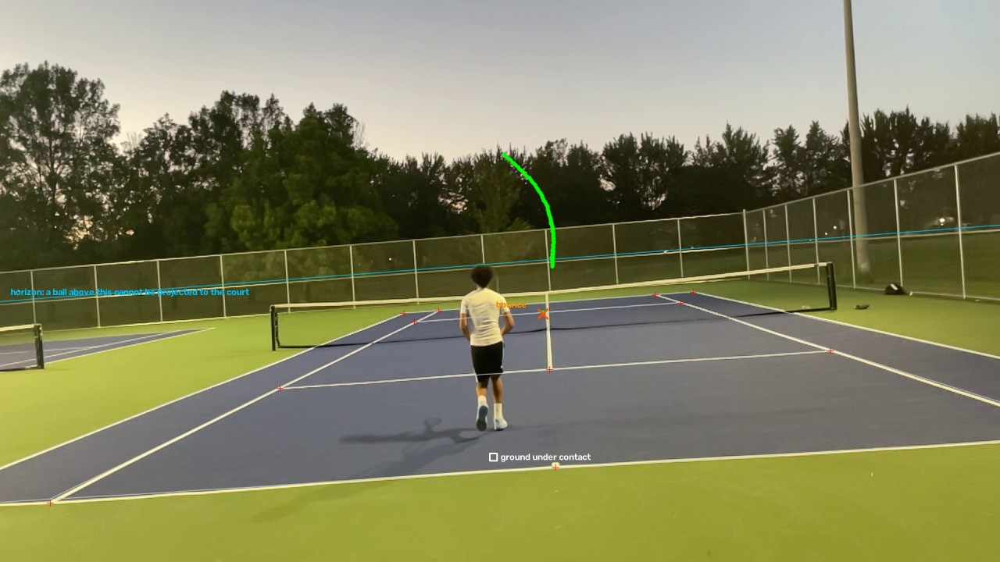
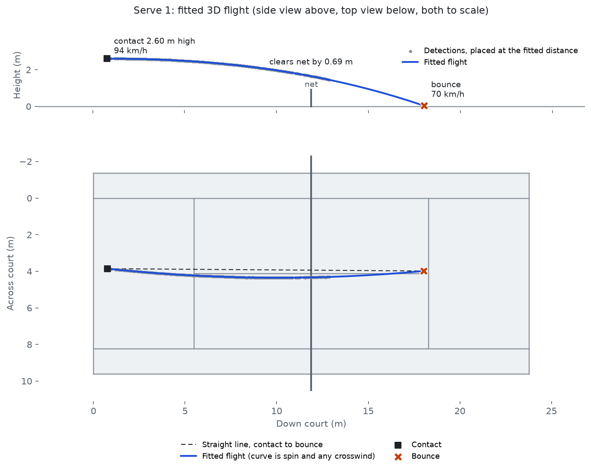

# Tennis Serve Analyzer

Measures tennis serve speed, spin, contact point and basic body mechanics from a
single smartphone video. One command, nothing marked by hand.





*The same serve twice. Top: the tracked ball path and detected bounce, from one handheld
phone clip. Bottom: its flight reconstructed in 3D, landing by the T. The
sideways curve in the top view is the spin.*

## How it works

1. **Detect the ball.** YOLOv8n trained at 1280 px on a public dataset plus labeled
   court footage, because the ball is only about 25 px wide in a 1080p frame.
2. **Track it.** A Kalman filter rejects false detections and bridges short gaps.
3. **Find the serve.** Contact is a sudden velocity change that follows a toss. The
   bounce is found by frame differencing, because the detector usually loses the ball
   there.
4. **Find the court.** White line segments are detected, and every way of matching
   four of them to a tennis court is tried. Matches that would need an impossible
   camera are discarded, and the rest are scored by how much of the court model lands
   on white pixels.
5. **Locate the camera.** The court's known dimensions give the camera's position,
   tilt and focal length. No checkerboard calibration is needed.
6. **Fit the flight.** A simulated ball (gravity, drag and spin force) is adjusted
   until its path, seen through that camera, passes through the detected pixels in
   every frame. The launch speed, contact point and spin are read off the fit.

7. **Measure the server (optional).** A pose model finds the body's joints. The
   camera model and the fitted contact point turn them into heights in metres: leg
   loading, reach, and how far the toss falls before it is struck.

A single camera only gives a direction to the ball, not its distance. Step 6 recovers
the distance because the flight must obey physics: gravity bends the path by a known
amount per second, and the bounce is at a known place on the court.

## Example output (unvalidated)

These are what the tool currently prints, shown to illustrate the output, not as
accuracy claims. No speed here has been checked against radar. Four serves by one
player, from three handheld clips. The 240 fps clips were filmed
from opposite ends of the court.

| Clip | View | Launch speed | Contact height | Net clearance | Sideways curve |
|---|---|---|---|---|---|
| serve3, first | behind the server, 240 fps | 94 ± 2 km/h | 2.60 m | 0.69 m | 0.42 m |
| serve3, second | behind the server, 240 fps | 106 ± 3 km/h | 2.58 m | 0.62 m | 0.33 m |
| serve4 | facing the server, 240 fps | 95 ± 7 km/h | 2.46 m | 0.66 m | 0.28 m |
| serve5 | facing the server, 60 fps | 116 ± 34 km/h | 2.48 m | bounce not seen | bounce not seen |

The ± values are the tool's own estimate of its sensitivity to pixel noise and the inputs
(court landmarks, bounce position, drag coefficient). They do not cover errors in the
method itself.

Body mechanics for the two serves filmed from behind (first pass):

| Serve | Hips drop while loading | Toss peak | Toss falls before contact | Wrist to ball at contact |
|---|---|---|---|---|
| serve3, first | 0.12 m | 3.64 m | 1.04 m | 0.51 m |
| serve3, second | 0.11 m | 3.68 m | 1.09 m | 0.55 m |

The last column is a check, not a result: it should be about a racket-length, and is.
The toss is a second check: a ball that falls for the measured 0.47 to 0.48 s drops
1.08 to 1.13 m under gravity.

What supports the numbers so far:

- The fitted flight matches the detections to about 0.6 px.
- Contact height came out at 2.58 to 2.60 m, against 2.54 m measured by hand from the
  video. It was not an input.
- The serve4 clip was never used to tune anything, is filmed from the other end of the
  court, and gives the same player a contact height within about 0.1 m and a similar
  speed and spin.
- Hand-marked and automatically detected court lines give the same speeds to within
  1 km/h.
- Handheld camera drift of about 36 px during a serve is reduced to about 0.5 px by
  matching each frame to the calibrated one.
- On simulated serves with known answers, launch speed is recovered to within 3% from
  behind and from the side (`tests/`).
- Rendered tripod clips from three camera positions that were never filmed, one of
  them side-on, go through contact, bounce, court and trajectory stages and return the
  launch speed to within 5%.

## Limitations

- **No ground truth yet.** Agreement between views is evidence, not proof.
- **Needs to see the bounce for full accuracy.** Without it, topspin cannot be told
  apart from distance. A speed is still reported, with a much wider error bar: hiding
  the bounce on the three 240 fps serves moved the result by 4% to 16%.
- **One player, one court, dusk light, handheld.** Tripod and side-on views are covered
  by rendered test clips only, not yet by real footage. Brightness thresholds for line
  detection were set at dusk.
- **Mechanics need the server large in the frame** (at least 220 px tall), and assume
  they stand still for a moment before the toss. Feet height is the least certain
  figure and is reported as a range.
- **Sideways force is spin and wind together.** A steady crosswind bends the path the
  same way, so the spin figure is an upper bound on a windy day.
- **Portrait and close-up clips are not supported.** At least two cross lines and two
  long lines of the court must be visible.

## Project layout

| Folder | Contents |
|---|---|
| `pipeline/` | Tracking, court and event detection, camera pose, flight physics, trajectory fit |
| `tests/` | Synthetic camera and simulated serves with known answers |
| `training/` | Labeling tools, dataset merge and model training |
| `evaluation/` | Detector checks and per-clip accuracy |
| `tracking/` | Results for the test clips |
| `legacy/` | Early homography demo, not used by the pipeline. Add your own `court.jpg` to run it |

| Script in `pipeline/` | Purpose |
|---|---|
| `run_pipeline.py` | Runs everything below in order and writes a summary per clip |
| `track_ball.py` | Detector on every frame, then a Kalman filter |
| `detect_events.py` | Contact and bounce frames |
| `detect_court.py` | Court landmarks from the painted lines |
| `calibrate_court.py` | The same landmarks by clicking, as a fallback |
| `camera_pose.py` | Camera position, tilt and focal length from the landmarks |
| `ball_physics.py` | Gravity, drag and spin force, and the integrator |
| `fit_trajectory.py` | The 3D fit, its uncertainty, report and plots |
| `serve_mechanics.py` | Joint heights from a pose model: leg loading, reach, toss |
| `estimate_speed.py` | The earlier contact-to-bounce method, kept as a cross-check |
| `calibrate_camera.py` | Checkerboard intrinsics. No longer required |

## Usage

Footage and trained weights are not included. Run commands from the repo root.

```
pip install -r requirements.txt

python pipeline/run_pipeline.py --video clip.MOV --weights best.pt --camera handheld --out_dir out
```

Use `--camera tripod` for a fixed camera. Add `--pose_weights weights/yolov8s-pose.pt`
for body mechanics (the model downloads on first use). Results are written to
`out/serves_summary.txt`, with a full report, a 3D view and an image overlay for each
serve in `out/serve0/`, `out/serve1/` and so on. A serve that cannot be measured is
listed with the reason, not given a guessed number.

Each stage can also be run on its own. See the docstring at the top of each script.

```
python -m pytest
```

## Next

Validate against radar, record tripod footage side-on and from behind, test on more
players and courts, and add pose tracking for serve mechanics.

## Attribution

Base detection dataset: `tennisball-3eqxr/tennis-ball-detection-qaxae` from Roboflow
Universe, licensed CC BY 4.0.

Court detection follows the approach of Farin et al., "Robust camera calibration for
sport videos using court models" (2004).
