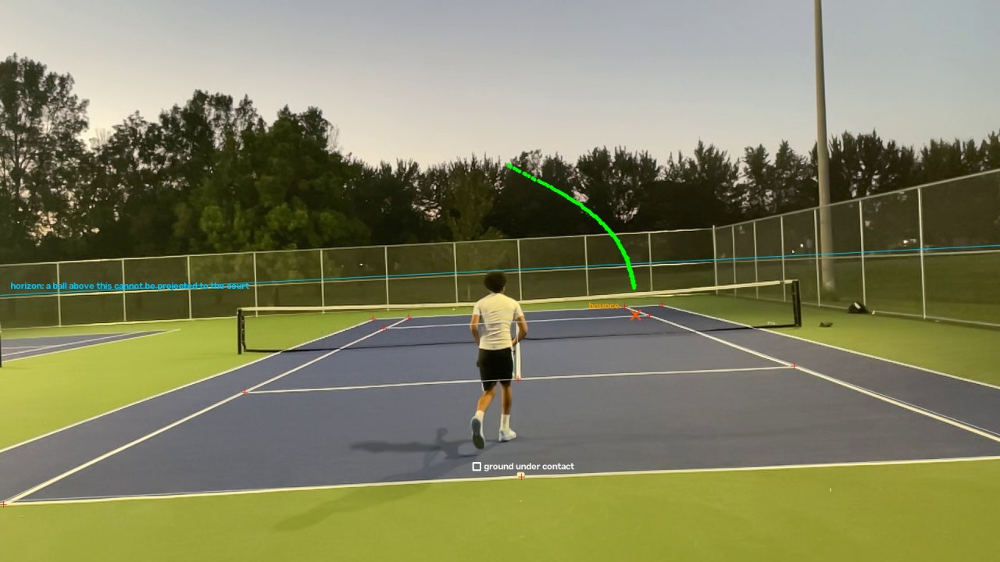

# Tennis Serve Analyzer

Estimates tennis serve speed from smartphone video, using a custom ball detector
and court geometry.



*Second serve: tracked ball path (green), detected bounce (orange ×), court calibration
points (red +). 90 ± 4 km/h average flight speed.*

## How it works

1. **Detect the ball.** YOLOv8n trained at 1280 px on a public dataset plus labeled
   court footage, because the ball is only about 25 px wide in a 1080p frame.
2. **Track it.** A Kalman filter rejects false detections and bridges short gaps.
3. **Find contact.** A sudden velocity change that follows a real toss.
4. **Find the bounce.** The detector usually loses the ball here, so frames are
   stabilized and differenced to follow it, and the bounce is where its descent and
   rise meet. If that evidence is missing, no speed is reported.
5. **Measure.** Court calibration places the bounce in metres. Distance from contact
   to bounce, divided by flight time, gives average flight speed.

## Court calibration

Tennis courts have standard dimensions, so the corners and intersections of the court
lines are points whose real positions are known. For example, the singles court is
8.23 m wide and the baseline is 5.485 m from the service line.

1. **Mark the corners.** Baseline corners, service line corners and the T are marked on
   a frame of the clip. These pair each pixel with its real position on the court. The
   clip used here has 11 points spread across the near and far court.
2. **Fit a homography.** This is the transform that converts any pixel on the court
   surface into metres. Extra points make a bad mark show up as a large error. Each
   point here is predicted to within 0.26 m by the others.
3. **Use it on points on the ground.** It locates the bounce and the ground under the
   contact point, and contact height is added separately. It only works on the court
   surface, so it cannot place a ball in the air.

For handheld footage, each frame is first matched back to the calibrated frame,
because a homography only holds for the exact view it was fitted on.

## Results

Two serves from one 240 fps handheld clip:

| Serve | Average flight speed | Estimated launch speed |
|---|---|---|
| First | 79 ± 3 km/h | ~95 km/h |
| Second | 90 ± 4 km/h | ~110 km/h |

Launch speed is a drag-model estimate, and is the figure closest to a radar reading.
The ± values cover input errors only. Automatic contact and bounce frames were within
1 frame of hand-marked ones. Detector mAP50 is 0.733.

## Limitations

**Status:** working end-to-end on one clip; not yet validated against radar.

- Event detection was tuned on these same two serves, and doesn't yet generalize to a
  second clip where the server is far from the camera.
- Court landmarks and the ground point under contact are still marked by hand.
- One camera cannot directly measure depth, so this gives average speed, not true speed
  off the racket.

## Project layout

| Folder | Contents |
|---|---|
| `pipeline/` | Tracking, calibration, event detection and speed estimation |
| `training/` | Labeling tools, dataset merge and model training |
| `evaluation/` | Detector checks and per-clip accuracy |
| `legacy/` | Early homography demo, not used by the pipeline. Add your own `court.jpg` to run it |

## Usage

Requires `ultralytics`, `opencv-python`, `numpy` and `matplotlib`. Footage and trained
weights are not included. Run commands from the repo root.

```
python pipeline/track_ball.py --video clip.MOV --weights best.pt --out_dir out
python pipeline/calibrate_court.py --video clip.MOV --frame 1014 --out out/court.json
python pipeline/detect_events.py --track out/track.csv --video clip.MOV --out out/events.json
python pipeline/estimate_speed.py --track out/track.csv --calibration out/court.json --camera tripod --video clip.MOV --events out/events.json --serve 0 --contact_ground_px X Y --out_dir out/serve0
```

## Next

Record tripod footage from behind the server and side-on, test on serves not used for
tuning, add camera pose for true 3D positions, and validate against radar.

## Attribution

Base detection dataset: `tennisball-3eqxr/tennis-ball-detection-qaxae` from Roboflow
Universe, licensed CC BY 4.0.
